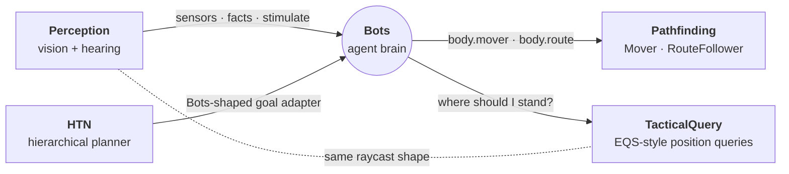

# Systems

**Gameplay and AI libraries for Roblox, written in Luau.**

Twenty standalone packages covering NPC AI, server-authoritative combat, latency measurement,
progression, trading, pets and spatial queries. Each one drops into a game on its own, takes
its game-specific pieces through configuration instead of reaching for globals, and keeps its
logic testable outside Studio. The repo carries **1,485 headless checks** that run under
[Lune](https://lune-org.github.io/docs) with no Studio, no Rojo and no place file.

Some packages were extracted from shipped games and made generic. Others were built new and are
vendored by games in development. This repo is upstream of those games: fixes land here first,
and each game pulls a snapshot.


| | |
|---|---|
| **Packages** | 20, none of which requires another |
| **Library code** | ~19,500 lines of Luau |
| **Tests** | 1,485 checks across 33 Lune suites (~13,500 lines including scenario policies) |
| **External dependencies** | One Wally package (`nezuo/spark`, used by Placement). Everything else depends on nothing. |

---

## Highlights

### An AI suite that composes by contract

**Bots · Pathfinding · Perception · TacticalQuery · HTN.** These are five packages with zero
dependencies on each other. They fit together because each one accepts the shape the others
produce, so no package imports another. Decision cores are pure Luau with no Roblox APIs, so
they run headless.



- **Bots** is a body-agnostic agent brain. It handles utility goal selection with commitment,
  sequenced actions with guaranteed exits, blackboard sensors and confidence-decaying memory,
  and squad token pools ("only two bots attack at once"). One scheduler runs every bot within a
  per-frame time budget, so under overload bots act late but none is skipped.
- **Perception** models awareness building up over time (`None → Suspicious → Detected`), not a
  binary raycast. When the raycast budget runs dry, targets it couldn't check keep their last
  value and are marked stale. It never extrapolates visibility it hasn't measured.
- **Pathfinding** has a shared broker that caps concurrent navmesh computations and ages its
  queue so no request starves. It answers every request exactly once, even one cancelled while
  queued. An agent parked at its destination sleeps: no path computations, no polling.
- **TacticalQuery** answers questions like "find cover from the threat" by scoring candidate
  points against weighted tests. It caps the expensive world checks: a 169-candidate grid costs
  about 32 probes, not about 185. When the shared budget is exhausted, it returns no answer
  rather than a position chosen from a half-checked set.
- **HTN** is a SHOP-style planner with backtracking, a decomposition trace, a bounded search
  and replanning that doesn't penalise a plan for adapting.

**Feasibility study:** three shipped games had their own bot systems: BuildAndBattle, CastleWars
and MechBattlegrounds. All three behaviour sets were rebuilt as policy modules on this suite
with **zero library changes**, and 58 headless scenario checks verify them. See
[Tests/REPORT.md](Tests/REPORT.md).

### Server-authoritative hit validation

**LagCompensation + TimeSync.** The client claims what it saw. The server keeps a ring buffer
of every combatant's pose on the engine-synced clock, rewinds each claimed target to the
attacker's timestamp, and re-tests the attack geometrically. Damage applies only to targets
both the client claimed and the server verified.

- Roblox's part-bounds queries can't look into the past, so moving characters are approximated
  as capsules and tested with sphere/box maths. Static targets are tested where they stand.
- Claims are bounded in both directions (too stale, too far ahead) and rate-limited per key.
  The same recorder flags impossible movement and rejects that player's claims for a short
  window. It flags, logs and limits; it never kicks.
- TimeSync measures round-trip latency in a way the client can't forge. A ping reply counts
  only if it carries a value the server sent, and each value works once. A client can't name
  its own latency, replay a ping or flood the sample window.

### Economy and progression that resist forged requests

- **Trading:** any change to an offer clears both players' agreement. Lines are totalled by
  item, so a duplicate can't slip past a per-line check. The swap is one atomic call that
  re-validates before it moves anything.
- **Levelling:** every XP source goes through one function. Multipliers (gamepass × rebirth ×
  event) are applied there and nowhere else, to both the XP amount and the XP-per-second rate.
- **LevellingRebirth:** a rebirth request carries no data, so a forged call looks exactly like
  a real one and gains nothing.
- **Companions** handles a pet collection, loadout and rigs. Two opt-in addons, Merge and
  Upgrades, can both raise a pet's level and install side by side without conflicting.

### World and infrastructure

- **Zone** detects when subjects enter and leave a volume. All zones share one `Heartbeat`
  connection. It tracks players, bots or anything with a position. It keeps those lists up to
  date from spawn and despawn events rather than querying every sweep. A cheap bounding-sphere
  check rejects distant subjects first, and each zone's sweep timing is offset so a large set
  of zones doesn't all sweep on the same frame.
- **Units** lets gameplay code treat real players and server-driven bots as the same type. A
  bot gets a negative ID, and real UserIds are always positive, so the sign tells them apart
  everywhere, including over the network.

---

## Package catalog

Every package has its own README with the public API, a complete usage example and its design
notes.

**AI and navigation**

| Package | Realm | What it does |
|---|---|---|
| [Bots](Bots) | server | Agent brain: sensing, utility goals, sequenced actions, squad tokens, a time-budgeted scheduler |
| [Pathfinding](Pathfinding) | server | `Mover` / `RouteFollower` contracts, `PathAgent`, authored routes, a shared navmesh broker, path costs |
| [Perception](Perception) | server | Vision with gradual awareness, a hearing system that accounts for walls, raycast budgeting |
| [TacticalQuery](TacticalQuery) | server | Position queries that generate candidates, score them and return the best, with an in-world debug view |
| [HTN](HTN) | server | Hierarchical task network planner with backtracking, plan monitoring and replanning |

**Combat and networking**

| Package | Realm | What it does |
|---|---|---|
| [LagCompensation](LagCompensation) | server | Rewind-based hit validation, movement checks and a cached line-of-sight filter |
| [TimeSync](TimeSync) | server + client | Per-player round-trip latency the client can't forge; feeds LagCompensation |
| [Units](Units/unit-system) | server + client + shared | One `Unit` type for players and bots: roster, ID resolution, ownership-safe teleport |

**Progression and economy**

| Package | Realm | What it does |
|---|---|---|
| [Companions](Companions) | server | Pets: declared content, per-pet update hooks, collection, loadout, server-owned rigs |
| [CompanionsMerge](CompanionsMerge) | server | Addon: merge duplicates into a higher level |
| [CompanionsUpgrades](CompanionsUpgrades) | server | Addon: pay to raise a level, with the currency supplied by the game |
| [Trading](Trading) | server + client + shared | Player-to-player trade sessions with an atomic, re-validated swap |
| [Levelling](Levelling) | server + client + shared | Permanent player level, one entry point for XP, a multiplier stack |
| [LevellingRebirth](LevellingRebirth) | server + client + shared | Addon: trade your level for a permanently faster one |
| [CommunityReward](CommunityReward) | server + client | Verify Roblox group membership, then pay the reward exactly once |

**World and infrastructure**

| Package | Realm | What it does |
|---|---|---|
| [Zone](Zone) | server | Enter/exit detection for rotated box, cylinder and sphere volumes, plus one-off geometry queries |
| [ObjectPool](ObjectPool) | any | Instance reuse with configurable release behaviour, an explicit cap policy and warm-up |
| [Placement](Placement) | server + client + shared | Grid-snapped building placement with a preview ghost and server validation |
| [Heatmap](Heatmap) | server | Anonymous player-movement heatmap, compressed and saved to a DataStore |
| [Nametags](Nametags) | server | Team-coloured overhead nametags with a health bar |

---

## Engineering principles

- **Injection over globals.** Anything a library would otherwise reach for, such as a
  scheduler, logger, latency source, catalogue or currency, is a config field with a sensible
  default. Each package works out of the box and can be wired into a host game's own systems.
- **Own your transport.** Networked packages create their own RemoteEvents instead of
  assuming a central registry exists at boot.
- **Never trust the client.** The server re-derives every claim: hits are rewound and
  re-tested, pings must echo a server-issued value, and trades and rebirths re-validate.
- **Degrade under load instead of spiking.** The bot scheduler, raycast budget, path broker
  and query probes all work within a budget. When it runs out, they slow down or decline to
  answer rather than drop frames or guess.
- **Fail loudly at construction, isolate at runtime.** Definitions are validated where they're
  written. At runtime, a hook that throws is contained, and the loop keeps running for
  everything else.
- **Deterministic when it matters.** Clocks and random number generators can be swapped out,
  so a headless run reproduces exactly.

---

## Testing

All tests run headless under Lune against each library's **real source**, not a copy. A small
Roblox shim provides `Vector3`, `CFrame`, `Instance`, services, `task` and a **manually stepped
`Heartbeat`**, so tests control time exactly and assert interval, drift and phase behaviour
rather than sampling it.

- **The shim was checked with mutation testing.** That turned up three places where it
  disagreed with the engine in ways that let assertions pass whatever the library did. All
  three are fixed and written up in [Tests/README.md](Tests/README.md).
- **Failure paths can be triggered on demand.** `failDataStore(n)` makes the next *n* writes
  throw the way the real service does. That is how "Heatmap probably loses data on a throttle"
  became a test, and then a fix.
- **The loader resolves the requires between a package's own modules and runs them in
  dependency order**, so multi-file packages load as shipped. Tests used to run against
  vendored copies. A mutation test showed a reverted bug fix surviving in a copy while every
  suite stayed green, and the copies were removed.

```sh
# one suite
lune run Tests/tests/test-lagcomp-rewind.luau

# everything (each file prints "N passed, M failed")
for f in Tests/tests/test-*.luau; do lune run "$f" | tail -n 1; done
```

| Area | Checks |
|---|---|
| Companions, Merge and Upgrades | 345 |
| Levelling and LevellingRebirth | 293 |
| Zone | 254 |
| LagCompensation | 119 |
| Trading | 117 |
| CommunityReward | 69 |
| ObjectPool | 65 |
| Pathfinding | 59 |
| AI scenarios (Bots: Mech, Castle, BnB) | 58 |
| Bots blackboard | 30 |
| TimeSync · Nametags · Heatmap | 26 · 26 · 24 |
| **Total** | **1,485** |

Perception, TacticalQuery, HTN, Placement and Units don't have dedicated suites yet.

---

## Repository layout

```
<Package>/
  README.md        API, usage example, design notes
  src/             the package; init.luau is the entry point, Types.luau holds the contracts
Units/unit-system/ shared/ server/ client/ modules (a drop-in, see its README)
Tests/
  tests/           one Lune suite per library concern, the harness and the Roblox shim
  src/             scenario policies: three shipped games' bots rebuilt on the AI suite
  REPORT.md        the feasibility study
CONVENTIONS.md     extraction rules and per-library maintainer notes
```

**Reading the AI suite:** start with Bots, the package the others plug into, then go through the
rest in any order. Each follows the same pattern: README, then `src/Types.luau` (the contracts
explain how the package fits together), then the one core module whose header comment is the
spec.

## Using a package

Copy the package folder into your place where its realm belongs (`ServerScriptService`,
`ReplicatedStorage`, or both for split packages) and require it. Wire in whatever it needs from
your game through its config. Placement is the one package with a Wally dependency; run
`wally install` inside its folder first.

---

Built by [Pranav](https://github.com/pranav-bt).
